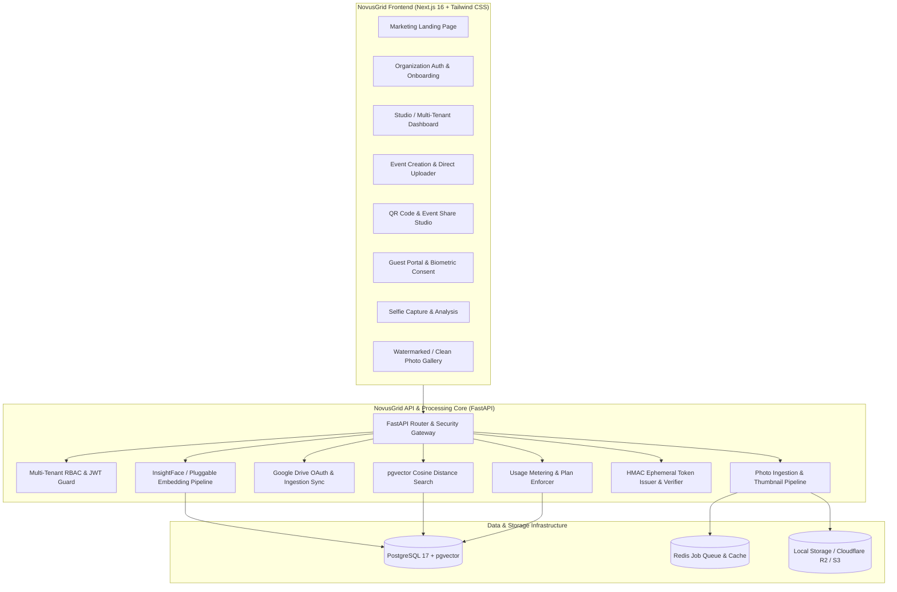

# Implementation Plan: NovusGrid Event Photos

**Product:** NovusGrid Event Photos — Commercial AI Event Photo Discovery Platform  
**Target Audience:** Event photography studios, wedding photographers, schools, universities, and corporate event organizers  
**OS Platform:** Windows 11 (PowerShell development, local runtimes)

---

## Architecture Overview

---

## Phased Execution Roadmap

### Phase 1: Audit, Baseline Stabilization & Windows Developer Tooling (Current Phase)
- [x] Full codebase, dependency, license, and architectural audit.
- [x] Create `PROJECT_AUDIT.md` and `IMPLEMENTATION_PLAN.md`.
- [x] Configure backend virtual environment (`Python 3.11` via `uv`).
- [x] Install and verify all 91 backend dependencies and 425 frontend dependencies.
- [x] Establish working `.env.local` configurations for Windows development without hardcoded secrets.
- [x] Verify backend tests (6 of 6 passed), frontend lint (`eslint`), typecheck (`tsc`), and Turbopack production build.
- [ ] Fix configuration path resolution in `backend/app/config.py` so tests and scripts run seamlessly from both repository root and `backend/`.
- [ ] Fix database lazy initialization in `backend/app/database.py` to prevent import crashes when testing without live database.
- [ ] Deliver `scripts/setup-windows.ps1` supporting both Docker and cloud PostgreSQL/Supabase modes.

---

### Phase 2: Brand Identity & Premium UI Redesign ("NovusGrid Event Photos")
- [ ] **Brand Aesthetic:**
  - Modern, executive SaaS interface featuring a deep slate/indigo palette, clean typography, refined borders, and accessible high-contrast accents.
  - Complete elimination of original "SmartGallery" earthy/terracotta theme.
- [ ] **Pages & Components to Build / Refine:**
  - **Landing Page (`/`):** High-converting marketing homepage featuring live interactive demo preview, value propositions for studios/schools, pricing tiers, and trust/privacy highlights.
  - **Authentication Screens (`/admin`, `/auth/*`):** Professional sign-in with Google OAuth and passwordless magic link support, clear organization context.
  - **Organizer Dashboard (`/admin`):**
    - High-level KPIs: Active events, total photos indexed, guest searches, match conversion rate, storage utilization.
    - Event grid with real-time indexing status badges, search counts, and action menus.
  - **Event Creation & Configuration Modal:**
    - Event details (Name, slug, date, venue, custom branding options).
    - Source selection: Direct Bulk Upload vs Google Drive folder.
  - **Event Share & QR Studio:**
    - High-resolution SVG/PNG QR Code generator.
    - Downloadable branded event table cards / poster export for print at venue.
    - One-click public link copying with configurable access password or PIN.
  - **Guest Experience (`/event/[slug]`):**
    - Mobile-optimized selfie capture interface with live camera flip, file upload fallback, and clear biometric privacy consent modal.
    - Real-time search processing animation.
  - **Matching Photo Gallery:**
    - Masonry / grid view of matched photos with high-speed thumbnail caching.
    - Full-screen lightbox preview.
    - High-resolution single and batch zip download with authorized short-lived tokens.
  - **Account & Privacy Settings:**
    - Configurable guest search data retention (7, 14, 30, 90 days or immediate purge).
    - Instant event data wipe option.

---

### Phase 3: Event Photo Workflow & Direct Photo Uploads
- [ ] **Dual Ingestion Architecture:**
  - Keep Google Drive integration for users wanting drive synchronization.
  - Build **Direct Photo Upload**:
    - Multi-file drag-and-drop uploader supporting JPEG, PNG, and WebP up to 25MB per image.
    - Instant thumbnail generation (400px WebP) to eliminate Google Drive proxy latency.
    - Local storage provider for development / testing with seamless S3/R2 abstraction for production.
- [ ] **Resilient Indexing Pipeline:**
  - Async Celery worker handling batch face extraction and vector insertion.
  - Handling multi-face group shots, single portraits, and zero-face images.
  - Detailed indexing status tracking per photo (`pending`, `processing`, `done`, `failed`) with actionable error logs and one-click retry.
- [ ] **Guest Search & Scoped Matching:**
  - Strictest event scoping: `FaceEmbedding.photo.event_id == requested_event_id`.
  - Configurable similarity threshold (default `0.40`).
  - Strict zero-persistence policy for guest selfie bytes.

---

### Phase 4: Multi-Tenant SaaS Architecture
- [ ] **Entities & Schema Migrations:**
  - `organizations`: `id`, `name`, `slug`, `logo_url`, `billing_plan`, `owner_user_id`, timestamps.
  - `organization_members`: `id`, `organization_id`, `user_id`, `role` (`owner`, `admin`, `photographer`, `viewer`), `invited_at`, `joined_at`.
  - Scoping `events` to `organization_id` instead of raw personal photographer ID.
  - `audit_logs`: tracking event creation, photo uploads, deletion, and settings modifications.
- [ ] **Tenant Isolation:**
  - Server-side middleware verifying organization membership on all administrative endpoints.
  - Guests restricted strictly to public published events without exposing organizer metadata.

---

### Phase 5: Commercial SaaS Features & Quota Enforcement
- [ ] **Tiered Subscription Models:**
  - **Starter (Free/Trial):** 1 active event, 200 photos, 7-day retention, NovusGrid watermark.
  - **Pro Studio:** 10 active events, 10,000 photos, 30-day retention, custom studio branding, high-res downloads.
  - **Enterprise / School:** Unlimited events, 100,000+ photos, custom domains, raw download packs, dedicated SLA.
- [ ] **Usage Metering:**
  - Real-time photo count and storage quota enforcement before uploads.
  - Event expiration dates with automatic archiving.

---

### Phase 6: Privacy, Biometric Compliance & Legal Safeguards
- [ ] **Legal Disclosures:**
  - Explicit biometric consent checkbox complying with BIPA (Illinois Biometric Information Privacy Act), GDPR Article 9 (special categories of data), and CCPA.
  - Purpose limitation: strictly matching user against specified event gallery.
- [ ] **Data Minimization:**
  - Zero storage of guest selfie images; immediate discard after embedding generation in memory.
  - Configurable guest session retention (scrubbing guest names/phones/emails after event conclusion).
- [ ] **Commercial Face Model Guidance:**
  - Pluggable model adapter to support commercially cleared models (e.g. CASIA-WebFace trained ArcFace) alongside the default research weights.

---

### Phase 7: Automated Verification & Production Deployment
- [ ] **Automated Test Suite:**
  - Unit tests for security, token validation, rate limiting.
  - Integration tests for direct upload, indexing, and vector similarity search with synthetic test portraits.
  - Multi-tenant isolation test suite verifying cross-tenant access is blocked.
- [ ] **Production Deployment Documentation:**
  - Docker Compose for self-hosted / VPS deployments.
  - Cloud serverless deployment blueprint (Vercel + Railway + Supabase + Cloudflare R2).

